<h1 align="center">
  <a href="https://struq.app/skill">
    <picture>
      <source media="(prefers-color-scheme: dark)" srcset="assets/readme/hero-dark.svg">
      
    </picture>
  </a>
</h1>

<p align="center">
  Struq is a free, open-source design skill for Claude Code, Cursor, Codex and other AI coding tools: your AI settles the direction, type, colour and motion before it builds, so your site looks studio-made, not AI-made.
</p>

<p align="center">
  <a href="https://struq.app/skill">Website</a>
  &nbsp;&middot;&nbsp;
  <a href="https://struq.app/docs">Docs</a>
  &nbsp;&middot;&nbsp;
  <a href="https://struq.app/showcase">Showcase</a>
  &nbsp;&middot;&nbsp;
  <a href="#the-struq-mcp">Struq MCP</a>
  &nbsp;&middot;&nbsp;
  <a href="https://struq.app/icons">Struq Icons</a>
  &nbsp;&middot;&nbsp;
  <a href="https://github.com/struqapp/struq-design/discussions">Discussions</a>
</p>

<br>

```bash
npx @struq/skill@latest
```

It finds the AI tools on your machine and installs the skill into each one. Then give your agent a brief:

```text
/struq a portfolio for an architecture studio in Rotterdam, dark, calm, lots of photography
```

<p align="center"><sub>MIT &nbsp;&middot;&nbsp; no account &nbsp;&middot;&nbsp; Node 18 or newer &nbsp;&middot;&nbsp; Claude Code, Cursor, Codex, OpenCode, Gemini CLI, Copilot and Windsurf</sub></p>

<br>

## <picture><source media="(prefers-color-scheme: dark)" srcset="assets/readme/h/film-dark.svg"></picture> Watch the Struq skill in 58 seconds

https://github.com/user-attachments/assets/19587b11-ef4c-4cf6-81ef-87230923e567

<p align="center"><sub>The launch film, silent. Also on <a href="https://struq.app">struq.app</a>.</sub></p>

<br>

## <picture><source media="(prefers-color-scheme: dark)" srcset="assets/readme/h/story-dark.svg"></picture> One brief, one stop, one site

<picture>
  <source media="(prefers-color-scheme: dark)" srcset="assets/readme/story-dark.svg">
  
</picture>

Your agent settles the idea, the motion language, the motif and a storyboard of scenes before it writes any markup. It stops once to show you that plan and asks for a logo, photos or real numbers if you have them. Then it builds from the plan and runs its own check until the page passes. It never invents a testimonial or a number the brief did not give.

<br>

## <picture><source media="(prefers-color-scheme: dark)" srcset="assets/readme/h/showcase-dark.svg"></picture> What a directed site looks like

<p align="center">
  <a href="https://struq.app/showcase/vuur">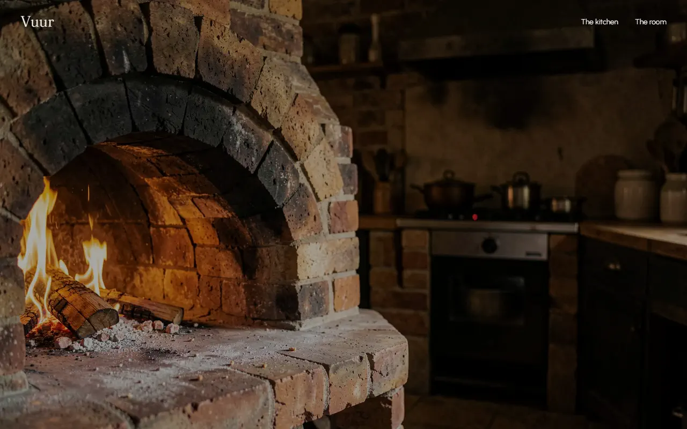</a>
</p>

<p align="center"><sub><b>Vuur</b>, a restaurant with a wood-fired oven. Built with the Struq skill by Claude Opus 5.5.</sub></p>

<p align="center">
  <a href="https://struq.app/showcase/forge">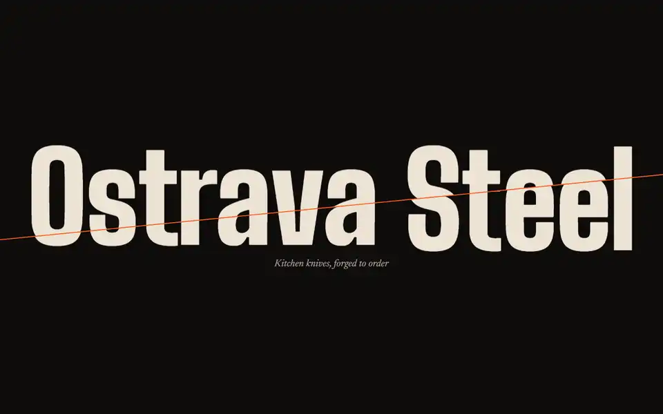</a>
  <a href="https://struq.app/showcase/brume">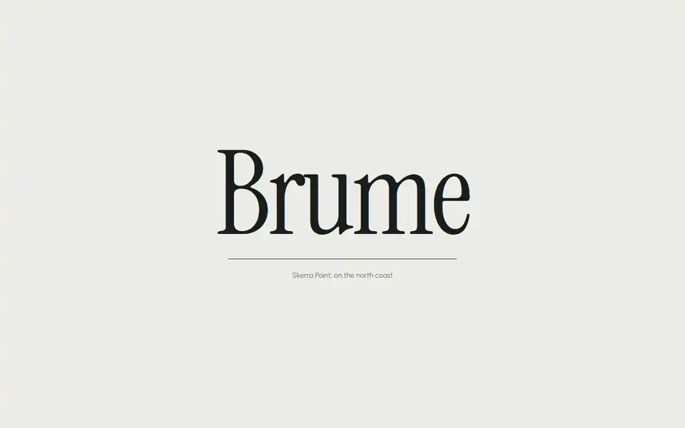</a>
</p>

<p align="center">
  <a href="https://struq.app/showcase/lowlight">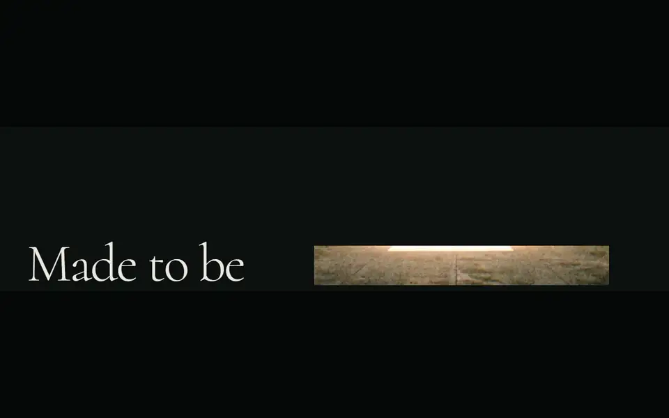</a>
  <a href="https://struq.app/showcase/halide">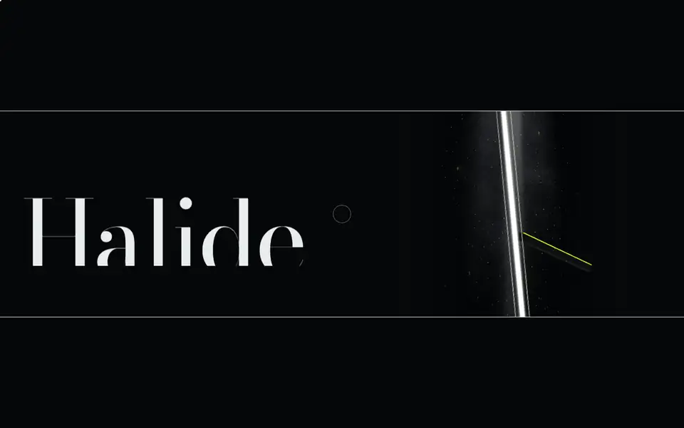</a>
</p>

<p align="center"><sub><b>Ostrava Steel</b>, <b>Brume</b>, <b>Lowlight</b> and <b>Halide</b> were directed the Struq way and written by Claude Opus as one file, before the skill carried the method. Much of what the skill knows about craft came from them. All five run live on <a href="https://struq.app/showcase">struq.app/showcase</a>.</sub></p>

Where the skill still loses: craft under pressure. An ambitious page with pinned scenes has more that can break than a plain one, and a reveal can still come out empty on a first build. The check catches most of it, and each release works on the rest.

<br>

## <picture><source media="(prefers-color-scheme: dark)" srcset="assets/readme/h/blocks-dark.svg"></picture> The blocks carry the motion

<picture>
  <source media="(prefers-color-scheme: dark)" srcset="assets/readme/blocks-dark.webp">
  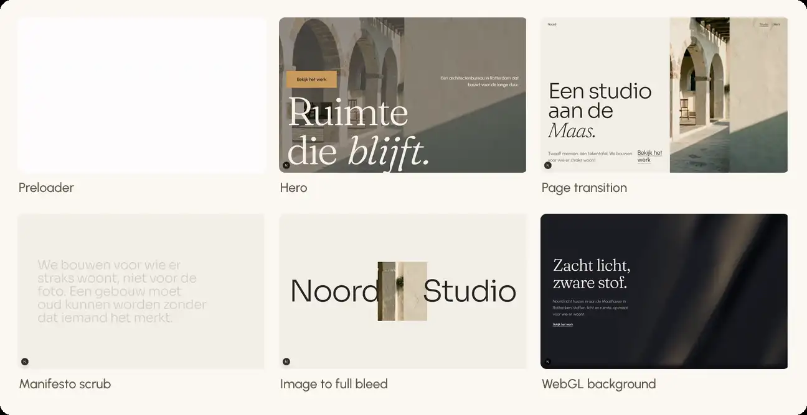
</picture>

Your agent picks the direction, sets the order and writes the copy. The motion comes from Struq's own catalogue: 44 admitted blocks, each a real React file that works in light and dark, with a still version for phones and for reduced motion.

<details>
<summary><b>All 44, by kind</b></summary>
<br>

| Kind | Blocks |
|---|---|
| Preloaders | 4 |
| Page transitions | 3 |
| Headers | 2 |
| Heroes | 5 |
| WebGL backgrounds | 3 |
| Showpieces | 9 |
| Scene transition | 1 |
| Sections | 15 |
| Footers | 2 |

Each one with its files, packages and props: [the catalogue](skills/struq/blocks/CATALOG.md). Every GSAP plugin they use is free on npm.

</details>

<br>

## <picture><source media="(prefers-color-scheme: dark)" srcset="assets/readme/h/direction-dark.svg"></picture> Direction before markup

<picture>
  <source media="(prefers-color-scheme: dark)" srcset="assets/readme/direction-dark.svg">
  
</picture>

Three briefs from the skill's worked examples, three directions from its canon. Each gets a palette, a type pairing and a motion language: weight settles, cut cuts, curtain lifts. The skill writes the choice into one token block that every block reads, so the whole page holds to it.

<br>

## <picture><source media="(prefers-color-scheme: dark)" srcset="assets/readme/h/mcp-dark.svg"></picture> The Struq MCP

<picture>
  <source media="(prefers-color-scheme: dark)" srcset="assets/readme/mcp-dark.svg">
  
</picture>

The skill works on its own, from the catalogue it ships with. Connect the Struq MCP and your agent reads the live catalogue instead, plus the whole Struq library. It is free; it asks for a free account because your AI tool connects as you.

```bash
claude mcp add --transport http --scope user struq https://struq.app/api/mcp
```

<details>
<summary><b>Codex, Cursor, VS Code, Windsurf and the Claude app</b></summary>
<br>

Codex, in `~/.codex/config.toml`:

```toml
[mcp_servers.struq]
url = "https://struq.app/api/mcp"
```

Cursor, in `~/.cursor/mcp.json` (then approve Struq under Settings, MCP):

```json
{
  "mcpServers": {
    "struq": { "url": "https://struq.app/api/mcp" }
  }
}
```

VS Code, Windsurf, Antigravity and the Claude app each want a slightly different shape. [The connect guide](https://struq.app/docs/connect) has every one, checked against each tool's own docs.

</details>

<details>
<summary><b>The seven tools</b></summary>
<br>

| Tool | What it does |
|---|---|
| `struq_richting` | The direction: one palette, one type pairing and one photo pack, as the token block the blocks read |
| `struq_blokken` | Lists the blocks, by kind or by words |
| `struq_blok` | One block as real files, with its packages, props and a usage example |
| `struq_controle` | The check your agent runs against its own files before it calls the work done |
| `struq_list_assets` | Pages through the library: palettes, typography, design systems, sections and imagery |
| `struq_search_assets` | Searches the library by mood, sector or name |
| `struq_get_asset` | One asset with its prompt and its exact colours and fonts |

All of them read; none of them changes anything in your account or your project. [More on the MCP](https://struq.app/mcp).

</details>

<br>

## <picture><source media="(prefers-color-scheme: dark)" srcset="assets/readme/h/icons-dark.svg"></picture> Struq Icons

<a href="https://struq.app/icons">
  <picture>
    <source media="(prefers-color-scheme: dark)" srcset="assets/readme/icons-dark.svg">
    
  </picture>
</a>

Struq builds reach for Struq Icons by default. Each moving icon makes one small move under the cursor that says what it does, and every icon on this page is one of them.

```bash
npm install @struq/icons
```

<br>

## <picture><source media="(prefers-color-scheme: dark)" srcset="assets/readme/h/details-dark.svg"></picture> The details

<details>
<summary><b>Commands, per agent</b></summary>
<br>

| Command | What it does |
|---|---|
| `/struq <brief>` | Plans, stops once for your approval, builds, checks and fixes |
| `/struq redesign <path>` | Keeps your brand, copy and components; swaps in blocks where the page is weakest |
| `/struq audit <path-or-url>` | Changes nothing. Returns every tell with its fix and the three changes that pay off most |
| `/struq direct <brief>` | Directed mode, for one continuous 3D experience across chapters |

In Codex the command is `$struq`. As a Claude Code plugin it is `/struq:struq`. In Cursor and OpenCode, ask for the struq skill by name.

</details>

<details>
<summary><b>Install options</b></summary>
<br>

```bash
# one tool only, or into the current project instead of your home folder
npx @struq/skill@latest --claude
npx @struq/skill@latest --project

# update by running it again, or take it out
npx @struq/skill@latest remove

# with the open skills CLI, which knows 70+ agents
npx skills add struqapp/struq-design -g
```

As a Claude Code plugin (the command is then `/struq:struq`):

```text
/plugin marketplace add struqapp/struq-design
/plugin install struq@struq
```

The screenshot step uses whatever browser tool your agent has (Playwright or similar).

</details>

<details>
<summary><b>What it fetches and sends</b></summary>
<br>

The Struq skill is instructions, the block files and five small Node scripts (`blocks.mjs`, `canon.mjs`, `images.mjs`, `check.mjs`, `log.mjs`) that your agent runs in your project. They read and write files there, including a build log, `STRUQ-LOG.md`.

- **Blocks and canon** ship inside the skill. Nothing is fetched to install a block or write the tokens.
- **Fonts** load from Google Fonts (or Fontshare, for a face that lives there) in the visitor's browser, as on any site with web fonts.
- **Photos**, for every slot your own photos do not fill: `images.mjs` reads the public pack list at `https://struq.app/api/media/packs` and downloads the chosen images from `https://struq.app/media/packs/`, or from the same paths on the old domain when struq.app does not answer. Offline it writes plates graded to your palette instead.
- **The MCP** (`https://struq.app/api/mcp`), if you connect it: your agent calls Struq's tools with your brief. Nothing else leaves your machine.
- **The installer** downloads the package from npm, looks for your AI tools' folders in your home folder and copies the skill into them. It sends nothing.

</details>

- **Something went wrong?** [Open an issue](https://github.com/struqapp/struq-design/issues/new/choose) and paste your `STRUQ-LOG.md`: it shows where the build went off.
- **A question, or a site you built?** [Discussions](https://github.com/struqapp/struq-design/discussions). Before and after screenshots are the most useful thing you can share.
- **Want to change the skill?** [CONTRIBUTING.md](https://github.com/struqapp/struq-design/blob/main/CONTRIBUTING.md) maps the repository and the house rules. Every release is in the [changelog](https://github.com/struqapp/struq-design/blob/main/CHANGELOG.md).

<br>

<p align="center">
  <a href="https://struq.app">
    <picture>
      <source media="(prefers-color-scheme: dark)" srcset="assets/readme/outro-dark.svg">
      
    </picture>
  </a>
</p>
