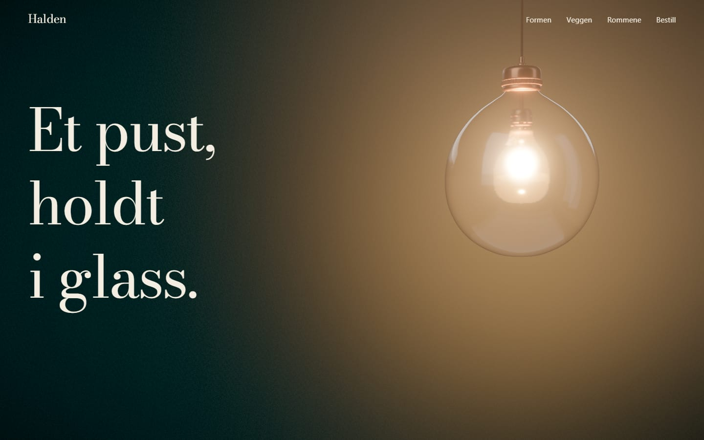
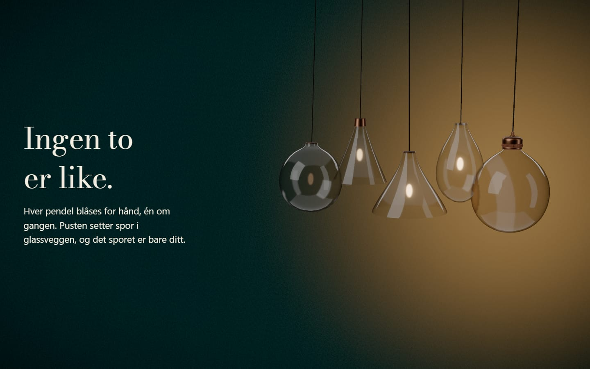
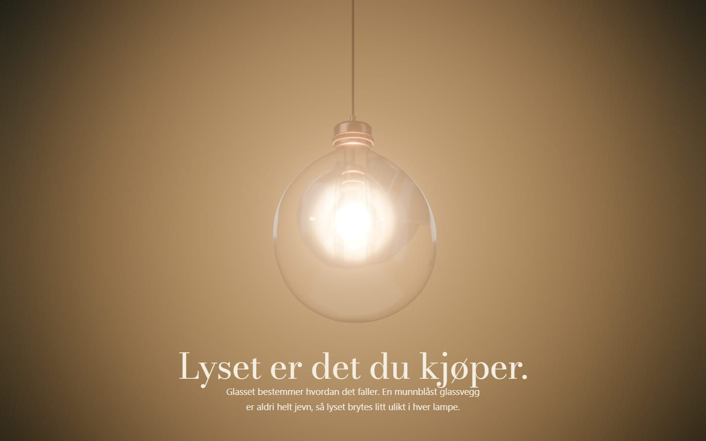
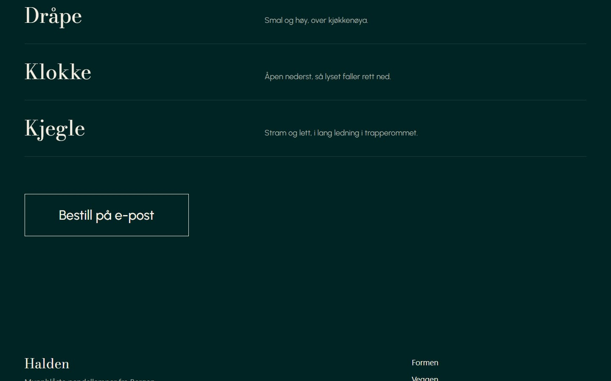
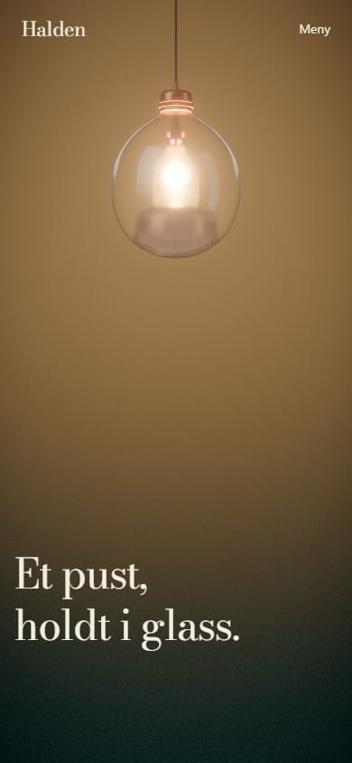
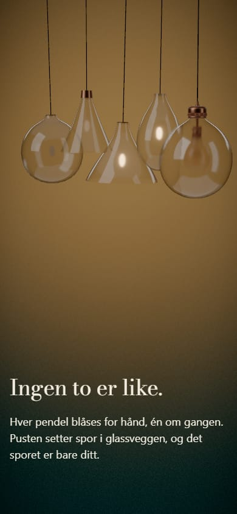

# Halden: product brands and shops

**Group:** product brands and shops (makers, fashion, ceramics, furniture, food products). The job of the page is to
make a visitor buy: meet the thing, believe in how it is made, see it in a home, and order it.

**Business:** Halden, a studio in Bergen that designs and hand-blows glass pendant lights. Norwegian (bokmål).

**Idea in one line:** every pendant is shaped by one breath, so the lamp you hang is a breath held in glass, and the
same lamp stays with the visitor from the first screen to the order.

## The skeleton

Every reference follows the same five parts. Copy the parts, never the copy.

| File | What it holds |
| --- | --- |
| `lib/site.ts` | Every fact and every line of copy: name, place, trade, nav labels, the products, the door, one block per scene. Nothing else in the site holds copy. |
| `app/page.tsx` | The scenes in order inside `<main>`, over the world. Nothing else. |
| `app/world.tsx` | The signature: one 3D world behind the whole page, keyed by the scenes' beat names. |
| `app/scenes/*.tsx` | One short file per scene, each a `<section data-beat="name">`, using kit parts where they exist. `Chrome.tsx` holds the header (the header-bar block, with `menuLabel` and `navLabel` in the site's language) and the footer. |
| `app/scenes/leave.ts` | The phone fade that keeps a leaving scene's type from passing behind the lamp. |
| `app/page.css` | The few page rules the scenes need on top of the kit's `blocks.css`. |

The scenes, in order: `Pusten` (the opening), `Formen` (a half-section drawing one breath fills), `Veggen` (a row
of five, no two alike), `Rommene` (where it hangs), `Blatimen` (the centerpiece: the lamp lit in the blue hour),
`Bestill` (the order close), then the footer.

## The signature

`app/world.tsx` is the kit's one-world pattern (references/realtime.md, One world):

- **`World`** is the fixed canvas behind the type. Its wall's pool of light is a signal: low in the dark, warmer for
  the rooms, wide open for the centerpiece.
- **`BeatCamera`** gives each beat an angle: eye level at the opening, from above for the row, from below and close
  for the centerpiece. It moves only in the half screen where one scene hands over to the next.
- **`Framed`** keeps the lamp whole and on the side the type leaves free, per beat: right for the opening, the row
  and the rooms, centre for the centerpiece. On a phone it sits in the upper centre above the type.
- **The kit's `Pendant`** is the lamp; four lighter lamps in the other blown forms and tints make the row of five.

Two patterns worth copying:

- **The frame box.** Framed measures what it holds once. The lamps sit in groups marked `userData.unframed`, beside an
  invisible box the size of one pendant, so the lamp can swell, drop on a long cord or share the frame with others
  without Framed rescaling it.
- **One hero, a light row.** Every kit `Pendant` renders the scene through its own glass, and five at once stall a
  laptop. The lamp keeps the `Pendant`; the four beside it are `RowLamp` in `world.tsx`: the same blown profiles in
  plain physical glass with a filament, and no light of their own (a light that comes and goes recompiles every
  material on the page).
- **Type leaves before the lamp.** On a phone the lamp sits above the type, so a sticky scene's type would scroll up
  behind it when the scene lets go. `scenes/leave.ts` fades it out in the first tenth of a screen, scrubbed.

Scenes over the world are see-through and keep their type on the free side; scenes with their own ground (`Formen`,
`Bestill`, `Rommene` on a phone) simply cover it. Long scenes are tall sections with a sticky inner screen, never a
GSAP pin, so the beats measure their real length and the camera never leaves while the scene still holds the screen.

## The close

`<Close shape="order">` with the products from `lib/site.ts` as items (no prices: the brief gave none) and
`site.door` as the one door. The brief gave no door, so the door is the skill's placeholder
(`mailto:post@example.no`, `placeholder: true`); check.mjs warns about it until the client gives a real one. Above it
the motif's last line: the cord draws down to a small drawn pendant.

## The finish

The mark is the pendant in half section (references/identity.md, `references/identity/halden-sheet.png`): the left
half drawn, the right half glass in the accent, on its cord, as the Formen scene draws it. It lives in `lib/site.ts`
as `brand` with the palette as hex and Bodoni Moda for the link preview, beside `kind: "shop"` for the JSON-LD and
`credit`. `Chrome.tsx` passes it to the header bar as `mark` and puts "Laget med Struq" on the footer's last line.
`blocks.mjs finish` wrote the rest: `app/layout.tsx` (metadata, theme colour, JSON-LD, `lang`), `icon.tsx`,
`apple-icon.tsx`, `icons/[kind]/route.tsx`, `opengraph-image.tsx`, `twitter-image.tsx`, `sitemap.ts`, `robots.ts`,
`manifest.ts`, `llms.txt/route.ts` and `not-found.tsx`. The brief gave no web address, so `url` waits for the client.

## On a phone

The 390 layout is designed, not squeezed. What Halden does there:

- **The lamp above, the type below.** Framed moves the lamp to the upper centre on a phone; every sticky scene
  (`Pusten`, `Veggen`, `Blatimen`) sets its type at the foot of the screen (`justify-end` with bottom padding), so the
  two never share a band.
- **Type leaves before the lamp.** `useLeave` fades a scene's type in the first tenth of a screen after it lets go, so
  it never scrolls up through the lamp.
- **The row travels past.** Five lamps do not fit across 390, so `world.tsx` shrinks the row by half on a phone and
  slides it past the type as `Veggen` scrolls, instead of shrinking it to fit.
- **A ground of its own where the world would crowd.** `Rommene` takes `bg-surface-1` below `md` (see-through above),
  so the list stands alone and the world fades out while it holds the screen; each room name is fitted to one line
  (`page.css`).
- **Thumb-sized doors.** The order close's door spans the screen, filled and 64px tall; the header's menu has a 44px
  hit area; body text stays at `text-body` (17px).

## Adapting it

Keep: the skeleton, one object that stays with the visitor, a scene that shows how it is made, a scene that shows it
in a home, one lit centerpiece, and the order close with the real products and the real door. Change the business in
`lib/site.ts` first, then the object in `app/world.tsx`, then the scenes that do not fit.

- **A furniture maker.** Swap the `Pendant` for a chair or table modelled to the kit's standard, or the kit's
  `TurnedObject` for a turned leg or stool. Formen becomes a joint in section (the kit's `SectionDrawing` with a
  timber material); the row of five becomes the range in its woods; the rooms stay.
- **A ceramicist.** Swap in the kit's `Vessel` (its forms and finishes are the row of five). Formen becomes the
  profile on the wheel; the centerpiece is the glaze in a raking light instead of a lit bulb.
- **A fashion label.** A 3D object is rarely the right signature: use photographs instead, with the kit's
  `GalleryRun` or `ImageCurtain` as the signature, and keep the skeleton, the rooms (where it is worn) and the order
  close with sizes and prices.
- **A food product.** The jar, tin or bottle as a `TurnedObject` profile, the row of five as the range of flavours,
  Formen as what goes into it, the rooms as when it is eaten, and the order close with pack sizes and prices from
  the brief.

