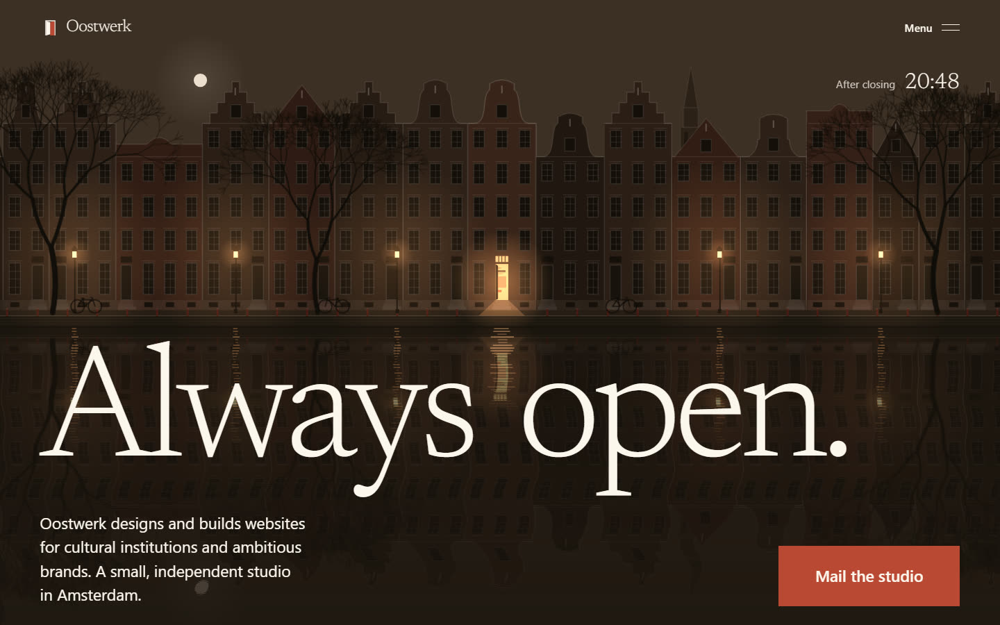
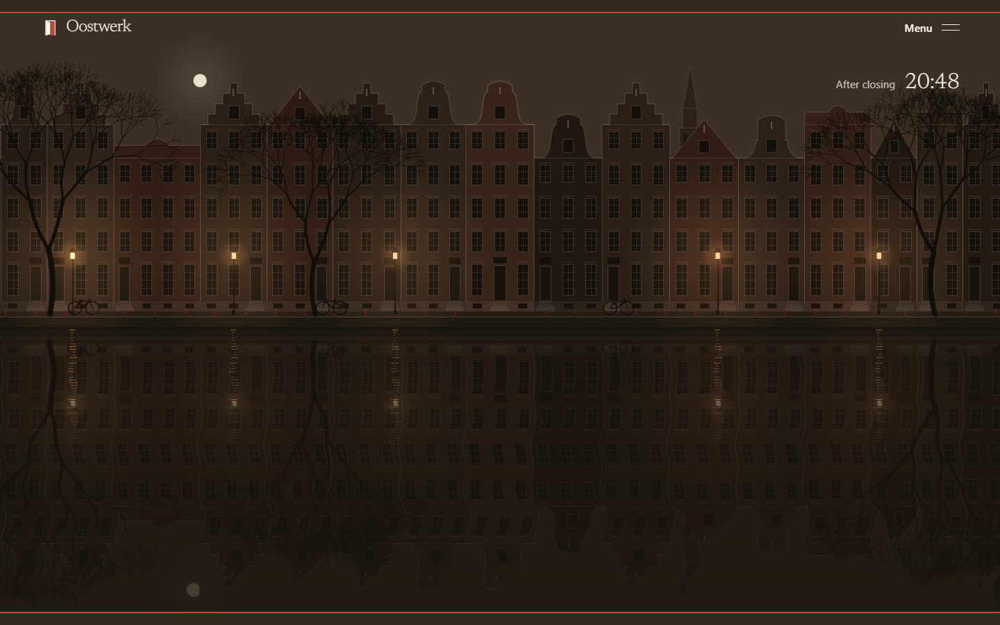
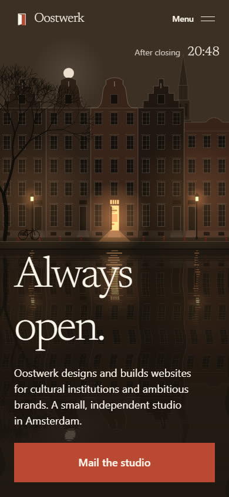
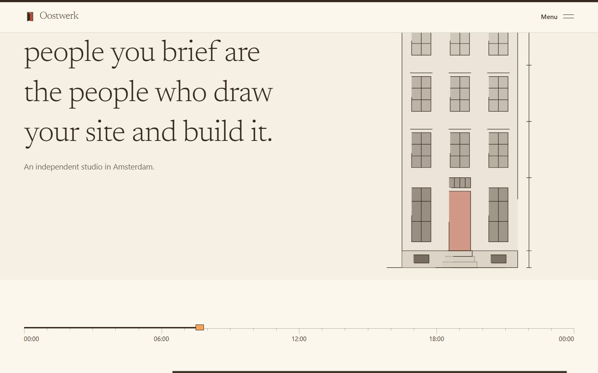
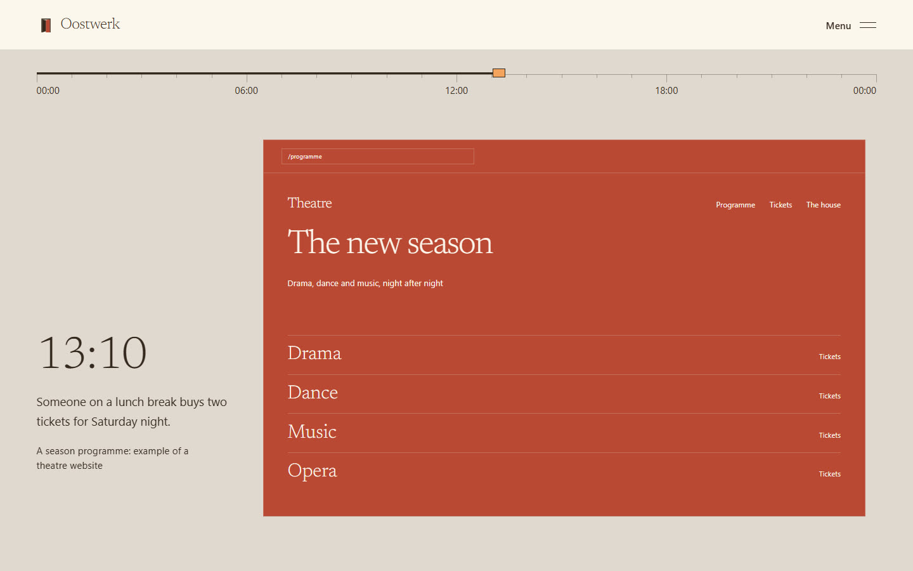
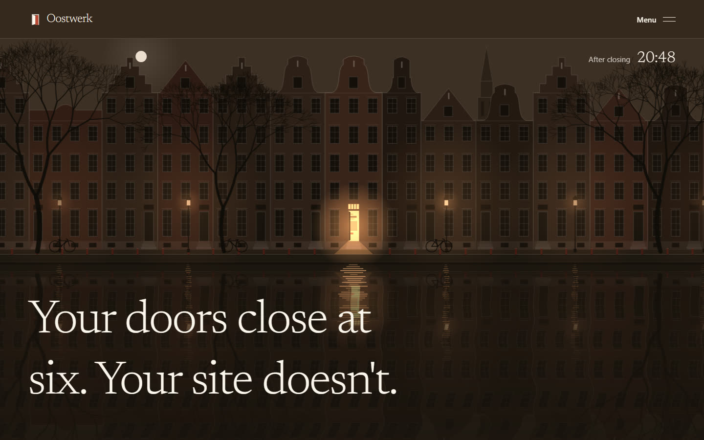

# Oostwerk: agencies and studios

**Group:** agencies and studios (web and design studios, branding studios, architecture practices, any practice that
sells its own way of working). The job of the page is to make a commissioner believe the studio thinks the way they
need, then write to it: meet the idea on the first screen, see the craft, live through what the work does, and find
the one door.

**Business:** Oostwerk, a small independent studio in Amsterdam that designs and builds websites for cultural
institutions and ambitious brands. English.

**Idea in one line:** a cultural institution's website is the one entrance to the building that never closes, so
the site opens on an Amsterdam canal at night where every window is dark except one front door.

## The skeleton

Every reference follows the same five parts. Copy the parts, never the copy.

| File | What it holds |
| --- | --- |
| `lib/site.ts` | Every fact and every line of copy: name, place, trade, the menu's chapters and labels, the door, one block per scene, the example pages of the day. Nothing else in the site holds copy. |
| `app/page.tsx` | The scenes in order inside `<main>`. Nothing else. |
| `app/scenes/Facade.tsx` | The signature: the canal at night in canvas 2D, used by the opening and again by the close. |
| `app/scenes/*.tsx` | One short file per scene. `Chrome.tsx` holds the menu curtain (gate variant, the mark beside the name, English labels) and the footer; `SitePage.tsx` draws an example web page in HTML; `Paintings.tsx` draws the paintings inside the example museum and archive pages. |
| `app/page.css` | The few page rules the scenes need on top of the kit's `blocks.css`. |

The scenes, in order: `Opening` (the street, "Always open."), `Drawn` (a museum visit page from its sketch to the
built page), `Studio` ("Small, on purpose" beside a canal house drawn and built with the scroll), `Entrances` (the
centerpiece: one ordinary day, 07:40 to 23:55, a pinned stage), `Street` (the canal again, full screen, the close line
on the water), `Order` (the two offers and the door), then the footer.

## The opening

The first screen is the signature at full bleed, moving from the first frame, and every frame around it speaks the
gate's language: the preloader, the menu curtain and the handovers (blocks/CATALOG.md).

- **The drawing.** `Facade.tsx` lays out a real street from one measure, the floor height: a raised ground floor on
  its plinth, three or four floors and a step, bell, neck, spout or cornice gable, two to four bays wide, white trims
  and hoist beams, stoops, lamps, bollards and the quay wall. Four layers (sky and moon, the far roofline with a spire,
  the street, elms and bicycles in front) are drawn once per size into their own canvases and composed every frame at
  their own depth. The water is the composed street mirrored row by row with a slow two-wave ripple, the lamps and the
  door laid on it as broken streaks. Only the middle house's door is lit: open, a small web page in its light.
- **The choreography.** `PreloaderGate` (in `layout.tsx`) opens its two bars like a pair of doors onto the dark street.
  On `whenUncovered` the quay lamps come on from both edges toward the middle, each with a catch; the far windows wake;
  the door flickers on last. `HeroOpener` waits `delay={1.05}` for that beat, then "Always open." rises through its
  line masks on the water. While it waits it marks `<html data-entrance="held">`, which look.mjs waits out.
- **Pointer and scroll.** The street leans with the pointer (eased, deeper layers more); the scroll drifts the layers
  apart; on the handover the camera walks toward the lit door (the street layer scaled about the door, the front
  layer faster) while the next scene slides over the pinned opener. The walk is the page's transition: a one-page
  site has no route change, so its handovers carry the gate's language instead.
- **The menu.** `MenuCurtain variant="gate"`: an accent line draws from the middle and the menu parts from it like the
  gate, the chapters rising through their masks. `labels` sets Menu and Close in the site's language, `mark` puts the
  door-ajar mark beside the name.

## What to copy

- **A drawn place as the opening.** A studio with no projects to show still has a point of view; draw the world it
  is about (a street, a room, a landscape) at true proportions, in layers, and put the idea's line on it.
- **The layer cache.** Draw static layers once per size (`layer()`), compose them each frame with `place()`, and draw
  only what changes live (lights, the door). It keeps a full-screen canvas at 60 fps on a laptop.
- **The water.** `drawImage` from the composed scene, one strip per two pixels, offset by two slow sines whose
  amplitude grows with depth. Keep the reflection near the water's own tone so type on it stays legible and look's
  over-object test sees a calm ground.
- **One street, two moments.** The close reuses `Facade` in `mode="close"`: every light on, then the lamps go out as it
  scrolls and only the door stays lit. The ending answers the opening.
- **No flat stretches.** Every middle screen holds something to look at: the sketch becoming a page, the house drawn
  and built beside "Small, on purpose", the pinned day with its pages, the street. The day's heading stands inside the
  pinned stage, so the centerpiece starts on its first screen.

## Adapting it

Keep: a drawn world on the first screen, full bleed and lit in a choreography that ends the preloader; the frames in
one language; a scene that shows the craft from sketch to finish; one pinned centerpiece that lives through what the
work does; the ending on the same world; the order close with the real offers and the real door.

- **A portfolio (a designer, a photographer, an illustrator).** Swap the street for the place the work lives (a desk at
  night, a wall of prints) or, with real work, a full-bleed project; `Drawn` becomes one project from first sketch to
  final; the day becomes the projects in time order, each page a real case; the close names how to commission.
- **A branding studio.** The street becomes a shopfront row where one sign is lit; `Drawn` shows a mark from sketch to
  system (the kit's `SectionDrawing` or a drawn sheet); the day becomes one brand across its touchpoints (a sign at
  07:40, packaging at 13:10, a screen at 20:00); `Studio` keeps the drawn building with the studio's own trade.
- **An architecture practice.** The signature is the practice's own kind of building in elevation at night (or a
  section), with one lit room; `Studio`'s scrubbed elevation becomes the hero drawing of a real project; the day
  becomes a building's day of use; the close lists the commissions it takes (new build, renovation, interiors).

## On a phone

The 390 layout is designed, not squeezed.

- **The street scales by its floor, not its width.** Three or four houses cross the screen with the middle house
  centred, one tree at the edge; the water starts just above the copy, so the line, the lead and the full-width door
  all stand on the water within the first screen.
- **The hour leaves with the first touch.** The readout sits under the bar and fades in the first twentieth of a
  screen of scroll, so it never passes under the header.
- **The day runs one hour under the other.** Without the pin, each hour opens on its page with the hour and its
  sentence under it; the archive's painting titles show only on a wide screen, so no running text drops under 15px.
- **The statement above the drawing.** `Studio` sets "Small, on purpose" first and the house under it, one scroll
  stop; the close stacks the offers and puts the 64px door under them.

## The finish

The mark is the door left ajar (references/identity.md): a doorway on the 48 grid, the leaf swung in from the left
hinge, the lit room behind it in the accent. It lives in `lib/site.ts` as `brand`, beside `kind: "service"`,
`schemaType: "ProfessionalService"` and `credit`. `blocks.mjs finish` wrote the rest (`layout.tsx` metadata and
JSON-LD, the icons, the link previews, `sitemap.ts`, `robots.ts`, `manifest.ts`, `llms.txt`, `not-found.tsx`). The
brief gave no door, so the door is the skill's placeholder until the studio gives its address; no projects, so the
day's pages and paintings are labelled examples of the trade.
