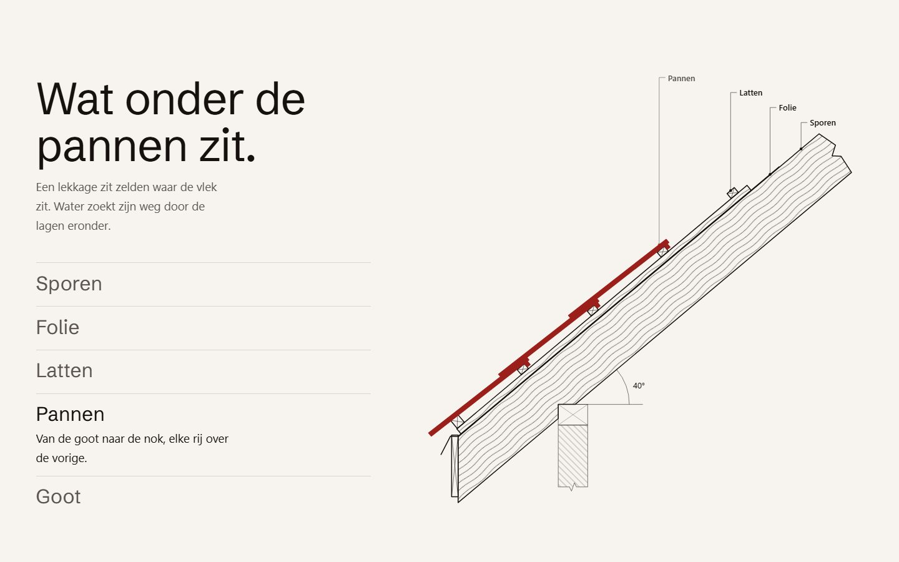
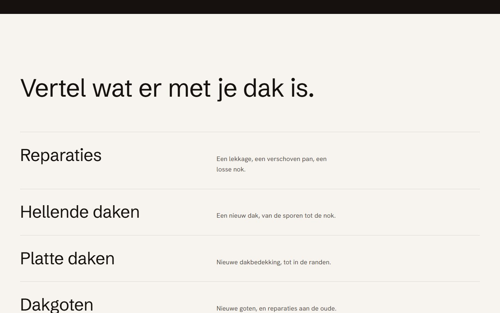
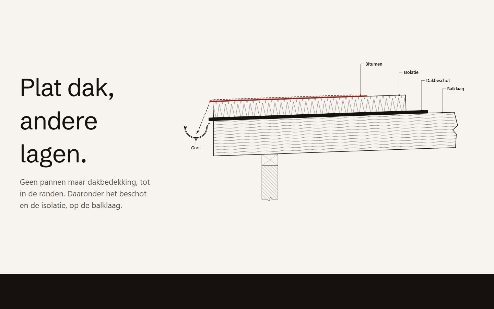

# Van Rijn: trades and local services

**Group:** trades and their neighbours (roofers, plumbers, electricians, builders, construction, garden and
landscaping, removals). The job of the page is to make a homeowner call or ask for a quote: believe the work is done
properly, see what the trade knows that they do not, and reach the phone with a thumb on any screen.

**Business:** Van Rijn Dakwerk, a family roofing company in Utrecht: roof repairs, new pitched and flat roofs,
gutters and leadwork. Dutch.

**Idea in one line:** a leak is almost never where the stain is, because a roof is dry only when every layer under the
tiles is right, so the site draws the roof in section and builds it layer by layer.

**No 3D.** The first version of this reference was a procedural 3D roof in the rain, and it read as a game. A roofer
wins on type, real material in photographs, one precise drawing and restrained motion. This version has no WebGL, no
three and no canvas.


## The skeleton

The same parts as every reference. Copy the parts, never the copy.

| File | What it holds |
| --- | --- |
| `lib/site.ts` | Every fact and every line of copy: name, place, the mark, the two doors (placeholders), the call bar's words, the five layers, the photos with their captions, the services. Nothing else in the site holds copy. |
| `app/page.tsx` | The scenes in order inside `<main>`, the header above, the call bar after. Nothing else. |
| `app/scenes/Lagen.tsx` | The opening and the signature in one held screen: the h1 beside the section drawing, then the layers. |
| `app/scenes/*.tsx` | One short file per scene. `Chrome.tsx` holds the header bar (the mark, the phone number as its action), the call bar and the footer. |
| `app/layout.tsx` | The stack preloader, the metadata and JSON-LD from `blocks.mjs finish`, `viewportFit: "cover"` for the call bar. |

The scenes, in order: `Lagen` (the opening, then the centerpiece: the roof built in section), `Daken` (four stills of
the craft as the kit's GalleryRun sheet), `Plat` (the same drawing as a flat roof), `Lek` (the phone door on ink),
`Offerte` (the order close: the five kinds of work and the two doors), then the footer.

## The signature: the drawn piece

`RoofSection` lives in the kit (`components/struq/kit/drawn`, installed by `blocks.mjs init`). It is a section through
the eave drawn to scale in millimetres: the wall and the wall plate as context, then rafters, membrane, battens, the
cover and the gutter. Timber is hatched along the grain or crossed where cut across, brick at 45 degrees, thin
sections solid, the cover in the accent, the pitch dimensioned. The layers end in steps up the slope, so each one
carries its own leader and name without crossing another. Weights, names and leader spacing are set in screen pixels,
so it reads at 390 and at 1440.

```tsx
<RoofSection progress={build} locale="nl-NL" labels={{ rafters: "Sporen", membrane: "Folie", battens: "Latten", cover: "Pannen", gutter: "Goot" }} />
<RoofSection cover="flat" progress={p} labels={site.plat.labels} />
```

Props: `cover` ("tile", "slate", "metal", "flat"), `pitch` (degrees), `layers` (which to draw, in build order),
`labels` (the names in the client's words, or false), `progress` (0 to 1; left out, it stands finished), `water` (0 to
1, the water's way drawn as a dashed line over the membrane into the gutter), `wall`, `dimension`, `locale`, `title`.
It has no motion of its own: the scene owns the scroll and passes `progress` and `water`.

How `Lagen` drives it: a 440svh section with a sticky screen (never a GSAP pin). One ScrollTrigger reads the section's
progress into state. On arrival the whole roof draws as the preloader lifts and the water's way runs over the folie
into the goot: the idea, a leak travels, on the first screen. Past 0.08 the roof is stripped back to the rafters while
the copy trades the opening for the layer list (the opening leaves first, the list arrives second, so they never
overlap); from 0.16 to 0.86 the scroll lays the four layers again, each named as it lands; the water runs once more at
the end. The list shows the landing layer in ink with its line; on a phone only that layer shows, in a band of fixed
height, so the drawing never moves.



## The photographs

No pack photo shows a roof, so the four stills are generated on the local GPU (deck-image, FLUX 3 Klein, three
variants each, the best kept, WebP). They are the trade's world, never the client's work: the captions say what is in
the frame ("Leien na een bui"), never "our roof". Ask the client for photos of their own roofs; they replace these. In this snapshot the stills are not rendered yet (the
GPU run waited on free memory), so `Daken` is switched off with `PHOTOS` in `app/page.tsx` and the shots show the page
without it; the prompts are the four scenes named above.

## The close

`<Close shape="order">` with the five kinds of work as items (no prices: the brief gave none) and two doors: the quote
as the large door, the phone beside it. Both are placeholders (`placeholder: true`) until the client sends the real
number and address; check.mjs warns about them.




## The finish

The mark is `references/identity/van-rijn.svg`: the rain stopped by the roof at the site's 40 degree pitch, the tile
layer in the accent. It lives in `lib/site.ts` as `brand` with the palette as hex and Schibsted Grotesk for the link
preview, beside `kind: "local"` and `schemaType: "RoofingContractor"` for the JSON-LD. The placeholder doors sit under
`call` and `quote`, never under `phone` or `email`, because the JSON-LD reads those as real facts. `url` is a
placeholder too. `blocks.mjs finish` wrote the icons, link preview, metadata, sitemap, robots, manifest, llms.txt and
404.

## What to copy

- **A drawing of the trade's own construction as the signature,** built by the scroll and named as it lands. It shows
  what only this trade knows, and it is the craft a studio would bring, where a 3D model would look like a toy.
- **The opening and the signature in one held screen:** poster type beside the drawing, so the best moment is on the
  first screen and the promise and the phone are read at once.
- **The phone within a thumb's reach:** the header's action on a wide screen, the call bar on a phone, stepping aside
  where a scene holds the same doors large.
- **The same drawn piece used twice** with other props (the flat roof), so the middle shows rather than tells.
- **Generated stills of the trade's material,** captioned as scenes, never as the client's work.

## Adapting it

Change the business in `lib/site.ts` first, then the drawing, then the scenes that do not fit.

- **A plumber.** The signature is a joint or a trap in section: the kit's `SectionDrawing` (`compression-fitting`
  template, or your own `drawing`) driven the same way, each part named as it lands, or a new piece in `kit/drawn`
  (a bathroom wall with its pipes behind the tiles). Lek stays, word for word in spirit: a burst pipe does not wait.
  The stills: a copper joint, a trap under a basin, a tiled wall. Plat becomes the other half of the work (heating,
  a boiler in section).
- **An electrician.** The drawing is a wall in section with the conduit, the box and the switch, or a meter cupboard
  as a single-line diagram drawn with the scroll; layers become circuits. No Lek: the urgent door is a power cut, so
  keep the scene and change the question. The stills: hands at a distribution board, a cable run, a finished switch.
- **A builder.** `RoofSection` itself serves a builder who does roofs; for walls and floors draw the build-up of an
  extension (foundation, cavity wall, insulation, floor) as a new piece in `kit/drawn` on the same pattern: a
  geometry function in millimetres, layers in build order, a `progress` prop. Plat becomes the floor or the wall,
  the close lists the kinds of work.

## On a phone

Designed at 390 first. The held screen puts the copy in a band of fixed height at the top and the drawing in the rest,
above the call bar, so no line runs under the drawing and nothing jumps when the copy changes. Only the landing
layer's name and line show. The drawing keeps 13px names and its line weights, because they are set in screen pixels.
The call bar is two doors of 56px, Bellen in the accent with the phone icon from `@struq/icons`, Offerte beside it.


