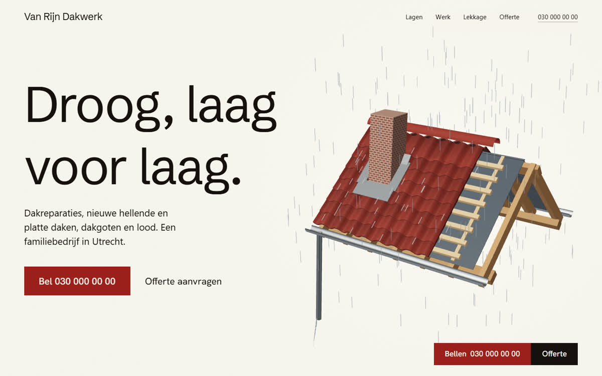
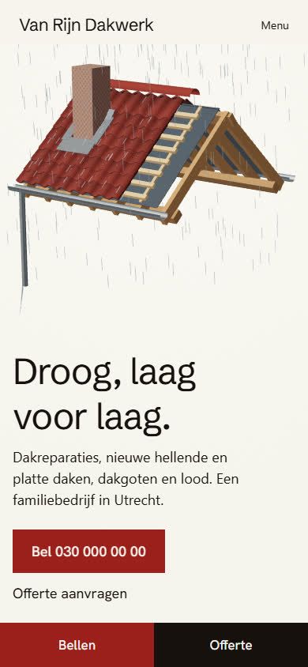
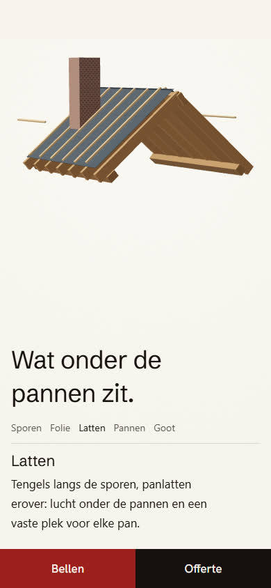
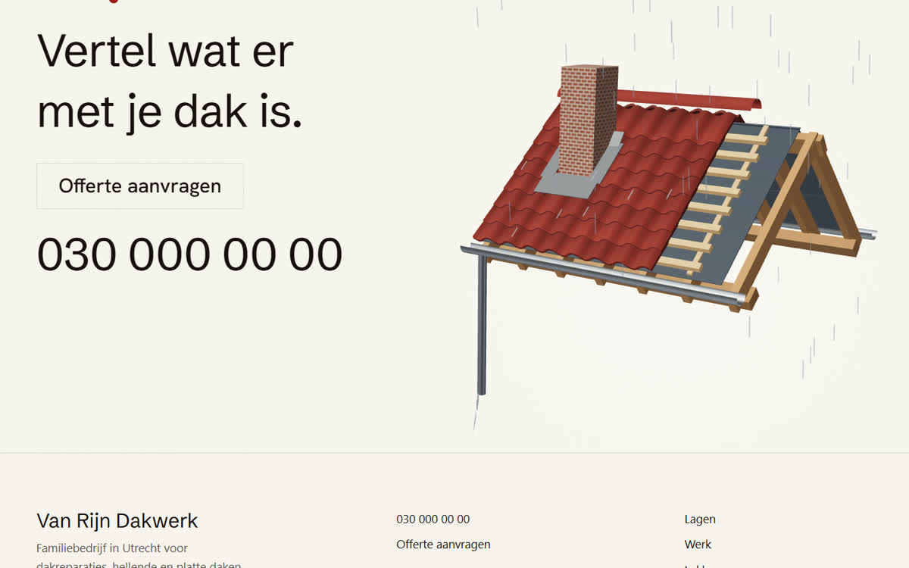
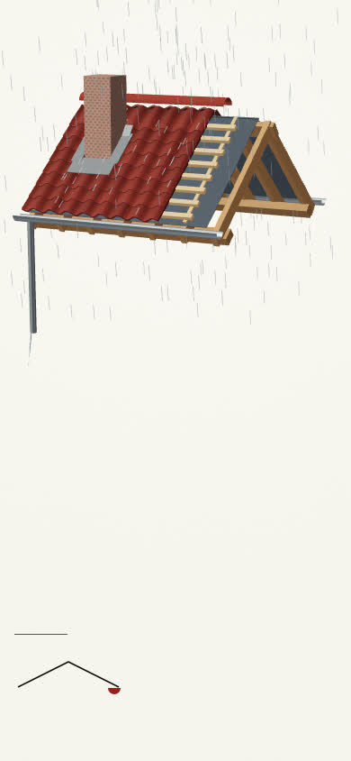

# Van Rijn: local trades and home services

**Group:** local trades and home services (roofers, plumbers, electricians, carpenters, painters, installers,
cleaners). The job of the page is one thing: get the visitor to call, or to ask for a quote. Its neighbours, served by
the same skeleton: construction firms, garden and landscaping, removals.

**Business:** Van Rijn Dakwerk, a family roofing company in Utrecht: roof repairs, new pitched and flat roofs, gutters
and leadwork. Dutch, in the roofer's own voice (je, not u). The phone number and the quote address are placeholders.

**Idea in one line:** a leak is never only in the tiles; a roof is dry because every layer under them is right, so the
page shows the roof standing in the rain, strips it to the rafters and builds it again layer by layer, while the phone
number never leaves the visitor's thumb.

## The skeleton

The same five parts as every reference. Copy the parts, never the copy.

| File | What it holds |
| --- | --- |
| `lib/site.ts` | Every fact and line: name, place, trade, nav labels, the two doors (phone and quote, both `placeholder: true`), the layers, the services with the roof each one shows, the close's question. Nothing else holds copy. |
| `app/page.tsx` | The scenes in order inside `<main>`, over the world, then the footer and the call bar. Nothing else. |
| `app/world.tsx` | The signature: one kit `Roof` behind the whole page, keyed by the scenes' beat names. |
| `app/scenes/*.tsx` | One short file per scene, each a `<section data-beat="name">`. `Chrome.tsx` holds the header (the phone number as its one action), the call bar and the footer. |
| `app/scenes/schedule.ts` | When the roof rains, is stripped and is built, as shares of each scene's scroll. The world and the Lagen list both read it. |
| `app/scenes/leave.ts` | The phone fade that keeps a leaving scene's type from passing behind the roof. |
| `app/layout.tsx` | The stack preloader (photoless), `data-temperament="weighted"`, and `viewportFit: "cover"` for the call bar. |

The scenes, in order: `Droog` (the opening: the roof in the rain, the h1, the phone as a filled button and the quote
link), `Lagen` (the centerpiece: the roof built again, each layer named as it lands), `Werk` (the services as kit
`ServicesList` rows; the active row changes the roof), `Lek` (the phone door for a leak today), `Offerte` (the door
close over the finished roof), then the footer.

## The signature

`app/world.tsx` is the kit's one-world pattern (references/realtime.md, One world) around the new kit object `Roof`:

- **`World`** is the fixed canvas behind the type, on a light palette: `post={false}` and the wall's ground passed
  encoded once more, so it lands on the page's exact bone (the post stack's tone mapping greys a light ground).
- **`BeatCamera`** keeps the camera near square-on with a little height; the three-quarter view comes from the
  roof's own `turn`, so the far edge of the world's wall never shows. The turn grows while the layers are named (the
  gable's section toward the reader) and shrinks for the leak, where the roof stands on the left.
- **`Framed`** puts the roof on the free side per beat. The roof carries its own frame box, so it can flatten, lift a
  tile or rain without being rescaled; on a phone the site passes a tighter box (`frame`) so the roof fills the width
  Framed gives it.
- **The build and the rain** are signals from the page's beats: finished and raining in Droog, stripped to the
  rafters as Lagen arrives, built again in Lagen with `lagenBuild`, raining again once the gutter is on.

Patterns worth copying:

- **One schedule for the object and the words.** `schedule.ts` maps Lagen's scroll to the roof's build, and the list
  names the layer with the kit's `roofLayerAt` on the same number, so the word in ink is always the layer landing.
- **Strip, then build.** The opening ends by stripping the roof to its rafters, so the next scene starts from
  something to look at, never an empty screen.
- **A row changes the object, not a picture.** Each service in `lib/site.ts` carries `roof` (cover, pitch, a lifted
  tile, rain, a turn, and a closer look: `zoom` about a `focus` point). Werk writes the active row on its section; the
  world eases the roof to it: closer on a tile lifted and set back for repairs, steeper for pitched roofs, stripped and
  laid in bitumen for flat roofs, closer on the gutter in the rain, closer on the chimney's lead.
- **The object makes way, never a rectangle.** No scene's ground ever crops the world canvas. On a phone the roof
  rises out of the frame while Werk's rows pass, and at the end it rises ahead of the close's type (`data-world-clear`)
  and the footer (`clearAbove` in `world.tsx`), so its edge is never cut by a section.

## On a phone

Designed at 390 on purpose, then checked at 768, 1024, 1280 and 1440.

- **The call bar.** A slim bar fixed to the bottom on every screen: Bellen and Offerte side by side, each half the
  width and 56px tall, above the home indicator (`env(safe-area-inset-bottom)` with `viewportFit: "cover"`). It slides
  away while Lek or the close holds the same doors large, and the footer keeps room under its last line. On a wide
  screen the same two doors sit small in the bottom right corner, the number written out.
- **The first screen.** The roof in the upper half, then the h1, one line on the work, the phone as the page's one
  filled button and the quote link, all clear of the bar. The header is the name and Menu; the number lives in the bar.
- **No hover-only content.** Werk's rows show every sentence under its name; Lagen shows the five names in one line and
  the active layer large under them, where a wide screen has the full list.
- **Nothing passes behind the roof.** Sticky scenes keep their type in the lower half and fade it as they let go
  (`leave.ts`); during Werk, whose rows are taller than a screen, the roof leaves the frame instead.

## The close

`<Close shape="door">` over the world: the finished roof stands dry on the right, the rain over; on the left the
motif's last line (a rule draws, then a small gable over a gutter), "Vertel wat er met je dak is.", the quote as a large
pressable door and the phone number set large under it. Not `order`: Werk has just shown the five services, and the art
director's round cut the list that repeated them. A trade with prices or packages from the brief takes `order`
instead. Both doors are the skill's placeholders (`placeholder: true` in `lib/site.ts`, listed under Assumptions);
check.mjs warns until the client sends the real number and address.

## The kit piece: `Roof`

`components/struq/kit/gl/objects/Roof.tsx`, exported from `kit/gl`. A gable roof in section that builds itself and
sheds the rain. Props:

- `cover`: `"tile" | "slate" | "metal" | "bitumen"`. Change it and the roof is stripped to the rafters and laid again.
- `pitch`: degrees, 0 to 55, a number or a Signal. Below about 5 it reads as a flat roof.
- `layers`: bottom up, from `"structure" | "deck" | "membrane" | "battens" | "cover" | "gutter"`; default
  `roofLayers(cover)`. `roofLayerAt(build, layers)` names the layer being laid.
- `build`: 0 (bare) to 1 (finished); the layers share it equally, pieces laid in a roofer's order.
- `rain`: 0 to 1: drops break on the cover, run down to the gutter and out of the downpipe; the cover wets and darkens.
- `lift`: one tile lifted and set back (a repair). `cutaway`: the stepped section at the gable (default on).
- `chimney`: a brick chimney flashed in lead. `colors`: per material (`tile`, `slate`, `metal`, `bitumen`, `timber`,
  `deck`, `membrane`, `batten`, `zinc`, `lead`, `brick`, `rain`). `frame`: the frame box Framed measures.
- `turn`, `lean`, `seed`, `position`, `scale`, as on the other kit objects.

## What to copy

The call bar and the header action, the phone on the first screen as the one filled button, the door close with both
doors set large over the object, the `Lek` door scene for the urgent visitor, one object that stays with the visitor and
changes with each service row, and the schedule shared by the object and the words.

## Adapting it

Change the business in `lib/site.ts` first (the doors, the services and what each shows), then the object in
`app/world.tsx`, then the scenes that do not fit.

- **A plumber.** Keep the call bar, Werk and Lek word for word in shape ("Lekt het nu?" is the plumber's question
  too). The signature becomes the pipe run under a basin: the kit's `SectionDrawing` with the `compression-fitting`
  template built by the scroll for Lagen, or an own instanced scene that lays the pipes with Roof's drop-in and the
  same schedule. Services: repairs, a new bathroom, central heating, drains.
- **An electrician.** Lek becomes "Storing?" with the phone. The layers are the consumer unit: rail, breakers, the
  earth-leakage switches and the cover, built piece by piece like the tiles. Services: faults, a new consumer unit,
  rewiring, charging points, only those the client does.
- **A builder or construction firm.** The `Roof` itself carries the top of a new build or an extension; add the
  `SectionDrawing` `wall` template for what is under the plaster. Werk rows become renovation, extension, new build,
  each with its own roof state. The quote is the primary door; Lek can go.
- **Garden and landscaping.** The layers are a path or a terrace: subsoil, membrane, sand, paving, built with the same
  drop-in, and the rain draining off into the soil. Services: design, paving, planting, maintenance.
- **Removals.** No layered object: keep the skeleton, the call bar and the quote close; the signature is a room of
  boxes stacking and leaving, built with Roof's instanced drop-in pattern. Lek becomes the date question.
